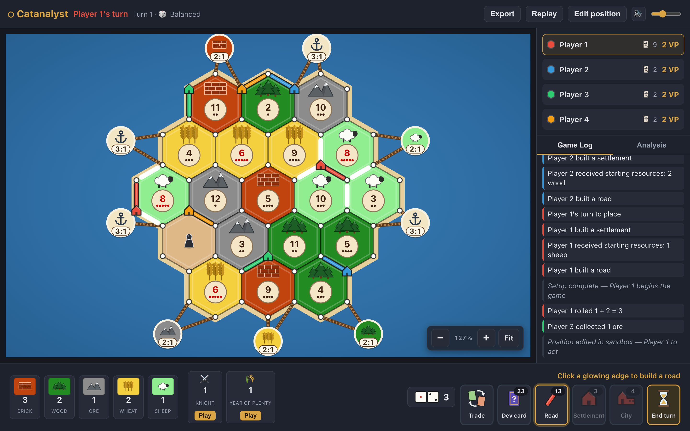

# Catanalyst

**A training tool for competitive Catan players.** Build any board, set up any position,
control the dice, and replay or branch any game, all on one screen.

<!-- TONY: personal intro here -->


<!-- Placeholder: add a screenshot at docs/screenshot.png or a short GIF at docs/demo.gif -->

## Who it's for

Players who already know the rules and want to get better: tournament and ladder players,
people coaching friends, and anyone who has ever said "what if I'd settled there instead?"
after a game.

## The problem

Casual Catan platforms are built for playing, not studying. You can't rebuild the board
from last night's game, set up the exact position where you made a choice, decide what
the dice will do, or rewind a finished game and try a different line. Chess players
have had analysis boards for decades. Catan players have screenshots.

## Features

- **Full base-game rules**: snake-order setup, production, robber (discard, move, steal),
  bank and port trades, player-to-player trades, all five development cards, Largest
  Army, Longest Road (with opponents' settlements breaking roads), supply limits
  (5 settlements, 4 cities, 15 roads), and a win at 10 VP with hidden VP cards.
- **Board generator**: standard random boards, or **balanced** boards with no touching
  6/8 and no touching equal numbers.
- **Board editor**: set every hex's terrain and number and every port's type. Validates
  against standard counts, with a free mode for custom layouts.
- **Shareable board codes**: every board packs into a 28-character code;
  `?board=<code>` opens it.
- **Dice modes**: Random, Balanced (a 36-combination deck, reshuffled when it runs low),
  or Scripted (type the rolls in advance, like `6 8 3+4`, and edit the queue mid-game).
- **Sandbox**: from any moment, place or remove pieces for any player, set hands, dev
  cards and knights, move the robber, and pick whose turn it is. Then resume normal rules
  from that position.
- **Replay and branching**: step through every action, jump to any turn, and "play from
  here" to branch a new game while the original stays intact.
- **Save, load, export**: games autosave in the browser; export and import them as
  `.json` (seed + board + actions). Imports are fully replayed and validated.
- **Analysis tab**: pip values on every open intersection, each player's pips and
  expected cards per roll, a histogram of rolled totals against the 2d6 expectation,
  and an income breakdown (rolls, setup, trades, dev cards, steals; losses to the robber,
  discards and Monopoly).
- Zoom and pan (wheel, trackpad pinch, touch), synthesized sound effects with a mute
  toggle, and an action log.

## Run it locally

```bash
npm install
```

```bash
npm run dev
```

Then open http://localhost:5173. Other scripts:

```bash
npm test
```

```bash
npm run build && npm run preview
```

`npm run lint` runs ESLint. Deployment: `netlify.toml` builds with `npm run build`,
publishes `dist`, and rewrites every path to the app so board links work.

## How it works

- **React 19 + Vite**, plain JavaScript, no UI libraries and no runtime dependencies beyond
  React.
- **Pure game engine** in `src/game/`: every rule is a pure function from state to state
  (or an error string). There is no React in that folder, so the whole rulebook is tested
  in Node.
- **Action-sourced and deterministic**: every change, including sandbox edits and dice-queue
  changes, is a plain action through one `dispatch(state, action)`. All randomness (dice,
  steals, the dev deck shuffle, random boards) comes from a counter-based seeded PRNG whose
  seed and position live in game state. A game is just `{ options, actions }`, which is what
  makes replay, branching, autosave and export cheap and exact.
- **Tests**: 30 Node suites (`tests/*.test.mjs`, about 600 assertions). These include a
  scripted bot that plays complete games, which must replay to a deep-equal state.
- The SVG board sits inside a CSS-transformed viewport, so hit-testing stays exact at
  any zoom.

## What I cut and why

- **Online multiplayer.** Colonist already does real-time play very well, and a backend
  (accounts, matchmaking, sockets, hidden-hand enforcement) would have taken most of the
  build time for something players already have. Catanalyst is hotseat: one screen, for
  studying, so everything stays offline and private.
- **AI opponents and move suggestions.** A good Catan AI is a research project, and a weak
  one teaches bad habits. The analysis tab gives you the numbers (pips, expected income,
  dice luck) and leaves the judgment to you.
- **Expansions** (Seafarers, Cities & Knights, 5–6 players). The base game is where
  competitive play happens.
- **Mobile-first layout.** It works on narrow screens but is designed for a desktop, which
  is where people study.
